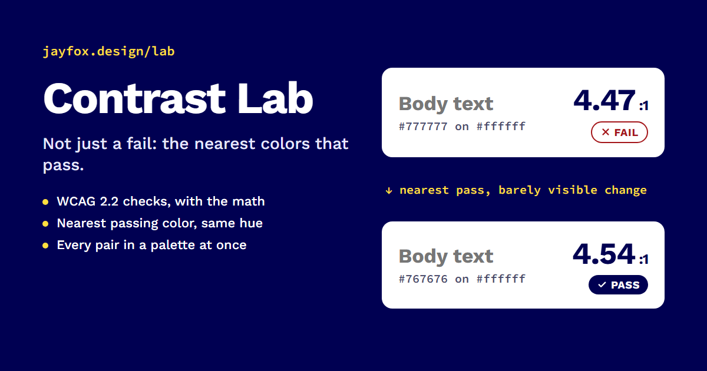

# Contrast Lab



Check a text color and a background against the WCAG 2.2 contrast rules, see the math, and get
the **nearest colors that pass** instead of just a fail. Or check a whole palette at once and
see every pair that works. Free, no sign-up, nothing leaves your browser.

It replaces a three-tool routine: an image color picker to get values out of a design, a
contrast checker for one pair, and a palette checker for the set. Here you pick or box colors
in a screenshot, get the nearest fix (for AA, and the step up to AAA), and fill a palette
straight from a screenshot of one.

Try it at [jayfox.design/lab/contrast-lab](https://jayfox.design/lab/contrast-lab/). Why it's
built the way it is, and who decided what: [DECISIONS.md](DECISIONS.md).

## What it does

- **Check a pair.** Type colors as hex, `rgb()`, `hsl()` or `oklch()`, or use the picker. The
  ratio is shown rounded _down_ (WCAG has no rounding: 4.499 fails 4.5), with pass or fail for
  body text and large text (SC 1.4.3), icons and control edges (SC 1.4.11) and AAA (SC 1.4.6).
  "Show the math" walks through the luminance formula with your numbers.
- **Transparent text** is painted over the background first, the way a browser does, and the
  math says so.
- **Nearest colors that pass.** For the rule you aim for, it offers the closest darker and
  lighter fixes for the text color and for the background. Each keeps the hue and moves only
  lightness, as little as possible, and is checked again from its exact hex code. When nothing
  can pass (for example 7:1 on mid grey, where the most possible is 4.68:1) it says why and what
  to change instead.
- **Check a palette.** Starts empty: add recent colors, paste a list, or paste a screenshot of
  an existing palette (Coolors, Figma) to pull its swatches. Up to 8 colors; a grid of every color as text on every other color, each
  cell drawn in its real colors, plus the list of pairs that pass. Any cell opens in the pair
  checker.
- **Pick from a photo.** Paste, drop or choose an image (it stays on the device). It opens
  large, with zoom and the live result beside it. Box a word, an icon or a border to find its
  foreground and background (judged at 4.5:1 for text or 3:1 for icons and borders), correct a
  wrong guess from the colors found in the box, or click colors with a magnifier. The photo's
  main colors become a palette you can use or check all at once. Keyboard works too.
- **Try colors fast.** The result is a live canvas painted in your colors. Hover a fix or a
  recent color to preview it; click to keep. Press X to swap. Drag swatches onto either color.
  Recent colors are kept in the browser. The swatch opens the color picker, and in Chrome and
  Edge the eyedropper picks a color from anywhere on screen.
- **Undo and redo** with buttons or Ctrl/Cmd+Z, for the pair and the palette; a typed color is
  one step.
- **Any format.** Show and enter values as HEX, RGB, HSL or OKLCH; switching never changes a
  result. Lists can be comma-separated hex with or without #.
- **Links.** The address always holds the current check (`#pair=…` or `#palette=…`), so a copied
  link reopens it.

## Usage counts

On the live site only, anonymous counts of which features get used go to the Lab's shared
receiver (the same one Quick Chess uses). No colors, images, typed text or fingerprints; a
pair is summarized as pass/fail and a ratio band. Skipped with Do Not Track or Global Privacy
Control. See `src/telemetry.ts` and DECISIONS.md.

## How it's built

`src/engine/` is plain TypeScript with no React, and all the logic lives there:

- `color.ts`: parsing, compositing, and sRGB ↔ OKLab/OKLCH (Björn Ottosson's matrices), with
  chroma reduced when a color falls outside what a screen can show.
- `contrast.ts`: relative luminance, the contrast ratio, the criteria and round-down display.
- `suggest.ts`: the nearest-pass search. It walks outward in OKLCH lightness from the original
  color until it finds a passing shade, then halves the gap to land right at the edge
  (about 1.7 ms per search on a laptop, so it runs live while you type or drag the picker).
- `palette.ts` and `share.ts`: the pair grid and the link format.
- `sample.ts`: reading a photo, including finding a foreground and background inside a box.
- `palette-extract.ts`: a photo's main colors (k-means in OKLab, same result every time) and
  the colors inside a box.
- `recent.ts`: the recent-colors list.

`src/ui/` and `src/App.tsx` are the thin React interface.

## Run it

Node 18.18+.

```bash
npm install
npm run dev        # http://localhost:5173
npm run check      # typecheck, lint, format, unit tests, build
npm run build && npm run test:e2e   # browser tests against the build
node scripts/share-image.mjs        # rebuilds public/og-image.png from docs/share/card.html
```

## Tested

- **86 unit tests** (Vitest): contrast ratios against reference values computed separately in
  Python from the WCAG formula; no rounding at thresholds (#777777 on white fails at 4.478,
  #767676 passes at 4.542); transparent text; parsing every supported format and a plain
  message for each kind of mistake; OKLCH round trips; every suggestion re-checked from its hex
  code; hue kept; "nothing passes" cases; palette grid and share links; photo sampling (exact
  pixel, edges, opacity-weighted averages, text found despite an anti-aliased fringe, light
  text on dark, a backwards box); palette extraction (main colors of a noisy image in
  order, the same answer every time, specks dropped, a cap on count) and box colors;
  recent colors.
- **63 browser tests** (Playwright, desktop Chrome and Pixel 7 emulation, against the built
  site): no page errors, using a suggestion fixes the pair, typos explain themselves, swap,
  links reopen a check (including a link pasted into the same tab), the palette grid and
  opening a cell, arrow keys on the tabs, nothing wider than the screen, control sizes; the photo
  workspace (a box over text in a real image, icon-or-border mode at 3:1, click-to-pick, zoom,
  the photo palette into palette mode, the keyboard path); X to swap (and not
  while typing); recent colors by click, Shift+click and the applies-to toggle; hover preview.
- **Its own colors:** every text and control color in the interface was run through the engine
  and passes AA.
- **Looked at** in screenshots at 1440×900 and on a Pixel 7 size, both modes.

## Not tested yet

- Real phones and tablets, Safari and Firefox.
- Dragging swatches (HTML drag and drop) by hand; the screen eyedropper (Chrome/Edge only) by hand.
- Photos with busy backgrounds, gradients or text over images: the box tool says when a box looks busy, but results there need a human check.
- A screen reader by hand (names, roles and live regions are set and checked in tests only).
- APCA, the proposed newer contrast method, is deliberately not included (see DECISIONS.md).

## License

MIT, see [LICENSE](LICENSE).
